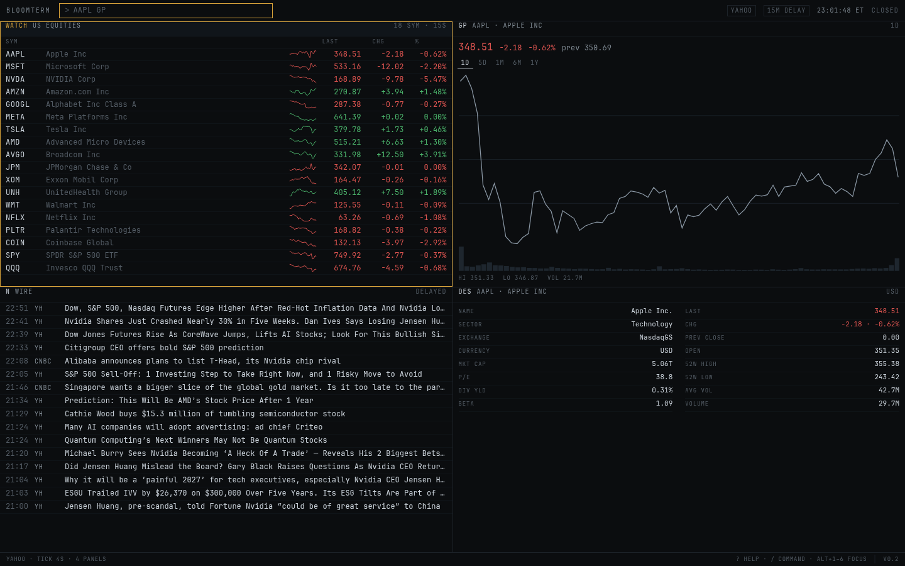

# bloomterm

A minimal, keyboard-first market terminal. One screen, six panels, no menus.

```
> AAPL GP
```



## Run it

```bash
python3 -m venv .venv
.venv/bin/pip install -e ".[dev]"
.venv/bin/python run.py            # http://127.0.0.1:8420
```

Python 3.12+. No Node, no bundler, no build step. The server renders the page; ~280 lines of
vanilla JS handle the command line, focus, and polling.

Offline or rate-limited? Run on generated data instead:

```bash
BLOOMTERM_PROVIDER=mock .venv/bin/python run.py
```

## Use it

Type a **ticker and a function**, or a function alone.

| Command   | Result                               |
| --------- | ------------------------------------ |
| `AAPL GP` | price graph for Apple                |
| `AAPL`    | description of Apple (default)       |
| `N`       | news wire                            |
| `ECO`     | cross-asset strip                    |
| `MOV`     | movers                               |
| `WATCH`   | the watchlist                        |
| `?`       | function list and keys               |

Aliases: `TOP`→`N`, `Q`→`DES`, `G`→`GP`, `WEI`→`ECO`, `MOST`→`MOV`.

| Key          | Action                    |
| ------------ | ------------------------- |
| `/` `ctrl+k` | command line              |
| `enter`      | run · open selected news  |
| `esc`        | blur / close / refocus    |
| `tab`        | next panel                |
| `j` `k`      | move through the wire     |
| `alt+1..6`   | focus a panel             |
| `[` `]`      | chart range               |
| `?`          | help                      |

Commands replace the **active** panel (the one with the amber border). The layout lives in
the URL, so reload and the back button both work, and a screenshot is a link.

News headlines are links: click one, or select with `j`/`k` and press `enter`, and the article
opens in a new tab. Nothing is scraped — the reader belongs to the publisher.

## The rules this follows

- Chrome does not exist: no cards, shadows, gradients, icons, or spinners.
- Three type sizes, one monospace family, tabular numerals.
- Colour is data. The accent appears only on focus and errors.
- Stale data keeps its last value and shows its age; it never blanks.
- Six functions is the cap. A seventh means deleting one.

## Where the numbers come from

Yahoo Finance via `yfinance` — free, no key, **15 minutes delayed**, and unofficial. It will
break eventually; that is the price of not paying for a feed.

- **Quotes** — one batched request for the whole watchlist, cached 15s and shared by every
  panel. Four panels asking for the same symbol make one upstream call, not four.
- **Charts** — daily bars are written to SQLite (`data/bloomterm.db`) on first view, then
  topped up. Closed bars are never refetched, so history is paid for once.
- **Descriptions** — `yfinance` info, cached 24h.
- **News** — RSS (Yahoo per-symbol feeds, CNBC, WSJ), deduped by title, cached 5m.
- **`ECO`** — a cross-asset strip (VIX, 10Y, dollar, gold, crude, BTC). CPI and payrolls need
  a FRED key, so they are not here; tradeable instruments answer the same question for free.

### Real-time ticks (optional)

Yahoo is 15 minutes delayed. Finnhub gives away a real-time US quote stream — 50 symbols, no
card — so the watchlist can tick live:

```bash
cp .env.example .env      # then paste a key from finnhub.io/register
```

Restart and the top bar changes from `YAHOO · 15M DELAY` to `YAHOO · FINNHUB RT`. What happens
underneath is deliberately narrow:

- the websocket subscribes to the watchlist and every trade updates **price, change, percent,
  and as-of** in the shared cache;
- Yahoo keeps supplying everything a trade feed does not: previous close, volume, the month
  of closes behind each sparkline, history, descriptions, news;
- a live price is re-applied after every poll, so a delayed snapshot can never drag the price
  backwards;
- if the socket drops, the label disappears and the app carries on polling. No key, no socket,
  no difference.

Everything is local. No accounts required, no analytics.

Want lower latency or better coverage? [docs/DATA.md](docs/DATA.md) compares the free options
(Alpaca, Finnhub, SEC, FRED) and what each would cost in code.

## Latency

The first paint used to wait on Yahoo. It no longer does:

- a daemon **prewarms** the quote cache at startup and refreshes it every ~15s **while a tab is
  open**, then stops on its own after two idle minutes;
- a stale cache is served immediately and refreshed off the request path;
- independent panels render **in parallel**;
- responses are gzipped, static assets are cached for an hour.

Measured on this machine: cold load 5.4s → 0.8s, warm load 310ms → ~15ms, HTML 32KB → 7KB on
the wire.

## Structure

```
run.py                  dev entry point
app/
  main.py               routes; renders panels from a spec, per-panel error boundary
  functions.py          the registry: the only list of functions
  command.py            "AAPL GP" -> Command
  layout.py             presets and the URL spec format
  symbols.py            the universe, ticker spelling, cross-asset list
  market.py             market clock and range vocabulary
  render.py             SVG paths, number formatting
  models.py             Quote, Candle, NewsItem
  store.py              SQLite: candle cache, news, kv
  config.py             .env loading
  data/
    __init__.py         provider selection (BLOOMTERM_PROVIDER)
    yahoo.py            quotes, candles, descriptions, news
    mock.py             deterministic offline provider
    news.py             RSS fetch, dedupe, cache
    quotes.py           shared TTL cache, single-flight, live overlay
    stream.py           Finnhub websocket -> cache (optional)
  templates/            shell + one template per panel
  static/               app.css (the whole design system), app.js
tests/                  pytest — parser, layout, store, provider shapes, panels
```

Adding a panel: an entry in `functions.py`, a template in `templates/panels/`, a branch in
`main._context`. Nothing else changes.

## Development

```bash
.venv/bin/python -m pytest -q                 # 79 tests, no network
.venv/bin/ruff check app tests run.py         # lint
.venv/bin/ruff format --check app tests run.py
```

`tests/conftest.py` forces the mock provider, so the suite never touches Yahoo or Finnhub.
`BLOOMTERM_PROVIDER=mock python run.py` does the same for the app itself.

## Docs

- [PLAN.md](PLAN.md) — scope, interaction model, build order, and what is deliberately missing
- [docs/DATA.md](docs/DATA.md) — free market-data sources compared, and why the stream is an overlay
